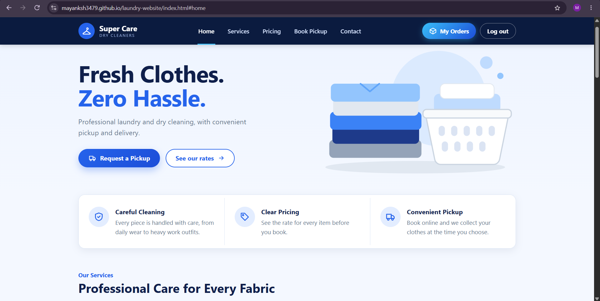
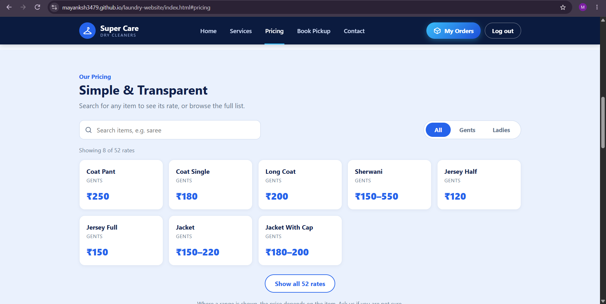
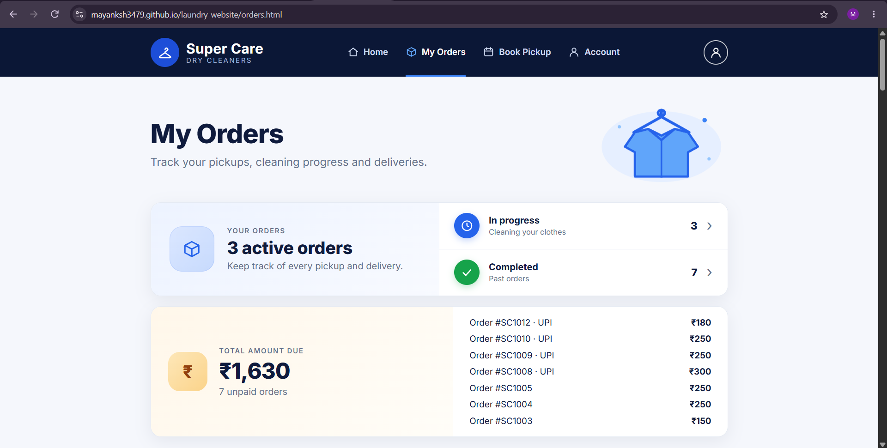

# Super Care Dry Cleaners

A website for a local dry cleaning shop. Customers can check the rates, book a pickup with photos of their clothes, and follow their orders. The shop gets a separate staff page to keep track of what's coming in.

**Live site:** https://mayanksh3479.github.io/laundry-website/

This is my first real web project. When I started I didn't know any HTML, so most of what's here I learned while building it. The shop's own rate boards are where the price list came from.

## Screenshots

## What it does

**For customers**

- Browse the whole price list, search it, or switch between Gents and Ladies.
- Make an account, log in, and reset a forgotten password.
- Book a pickup. You pick a date and time, search for each item, set how many pieces there are, and add one photo for every piece, so the shop can see what's coming before it arrives.
- Photos are shrunk in the browser before they upload. A 4 MB phone photo ends up a few hundred KB, which matters because storage on the free plan is small.
- Follow each order on a My Orders page, with a progress bar that goes from order placed to picked up, cleaning, ready and delivered.

**For the shop**

- A staff page (`admin.html`) for seeing and managing the orders that come in.

## Built with

- HTML, CSS and plain JavaScript, with no framework
- [Supabase](https://supabase.com) for the database (Postgres), logins and private photo storage
- GitHub Pages for hosting

I kept it framework-free on purpose, so I'd understand every line instead of hiding behind a tool.

## How the files are organised

| File | What it does |
| --- | --- |
| `index.html`, `home.css`, `home.js` | The home page and the price list. All the rates live in one list at the top of `home.js`. |
| `script.js` | The booking form: checks the date, time and items, shows photo previews, shrinks and uploads the photos, then saves the order. |
| `login.html`, `login.js` | Sign up and log in. |
| `reset-password.html`, `reset-password.js` | The page the password reset email links to. |
| `orders.html`, `orders.js` | A customer's own orders and their progress. |
| `admin.html` | The staff page. |

## How the data is protected

The key in the JavaScript files is Supabase's publishable key. It's meant to be public, and anyone can see it by viewing the page source. What actually keeps data safe are Row Level Security policies in the database: a customer can only read their own orders, and photos sit in a private bucket that the public can't open. The secret key is never used anywhere in this site.

## The database

Two tables and one storage bucket.

- `pickup_requests` has one row per order: the delivery time, the customer's id, and a status.
- `request_items` has one row per item in an order: the category, the quantity, and the paths of its photos.
- `request-photos` is the private bucket the photos are uploaded to.

The status is one of `pending`, `picked_up`, `washing`, `ready` or `delivered`. The progress bar on My Orders is built from those exact words.

## Running it yourself

1. Clone the repo.
2. Create a free Supabase project, then set up the two tables, the private `request-photos` bucket and the access policies.
3. Put your project URL and publishable key at the top of `script.js`, `login.js`, `reset-password.js` and `orders.js`, and in the script that `admin.html` loads.
4. In Supabase, open Authentication, then URL Configuration, and set the Site URL to wherever you host the site.
5. Open `index.html` with a local server such as the Live Server extension in VS Code. Opening the file directly breaks the login redirects.

## What isn't finished

- The Supabase free plan pauses a project after a week with no activity, and its built-in email sender only delivers to team members. A real launch needs a proper email service and either a paid plan or a way to keep the project awake.
- Prices are typed into `home.js`, not stored in the database, so changing a price means editing a file.
- GitHub Pages is fine for a demo, but its rules don't allow running a business on it. A real launch should move to another host.

## What I'd add next

- Saved pickup addresses, so a customer enters theirs once.
- A message to the customer when their order status changes.
- Prices in the database, with a way for staff to edit them on the staff page.

## What I learned

- How Git and GitHub work together, and that committing often is the reason a deleted folder isn't a disaster.
- How to find a bug with the browser's Console and Network tab instead of guessing.
- That checking things in the page isn't security. The database has to enforce the rules too.
- That one wrong letter, like `price-list` against `price-lists`, can break a whole feature.

Made by [@Mayanksh3479](https://github.com/Mayanksh3479).